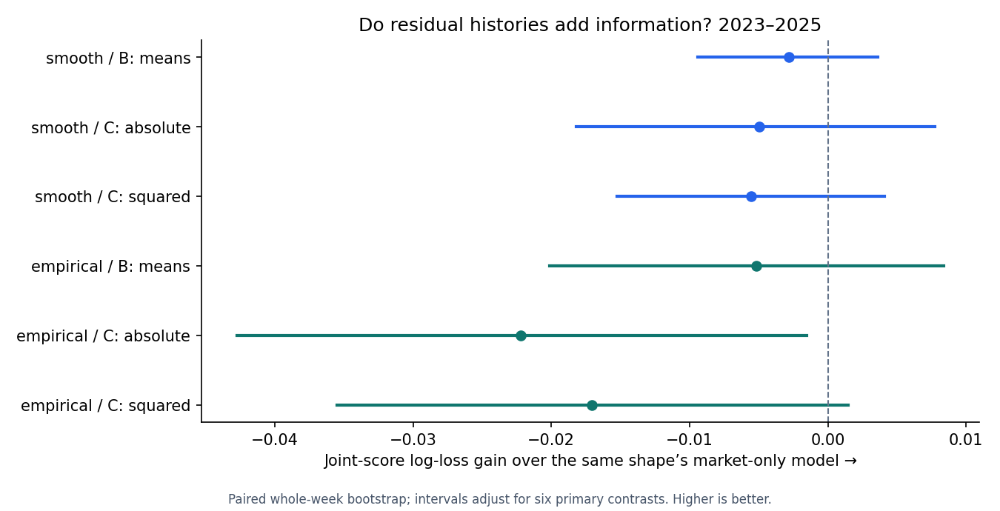
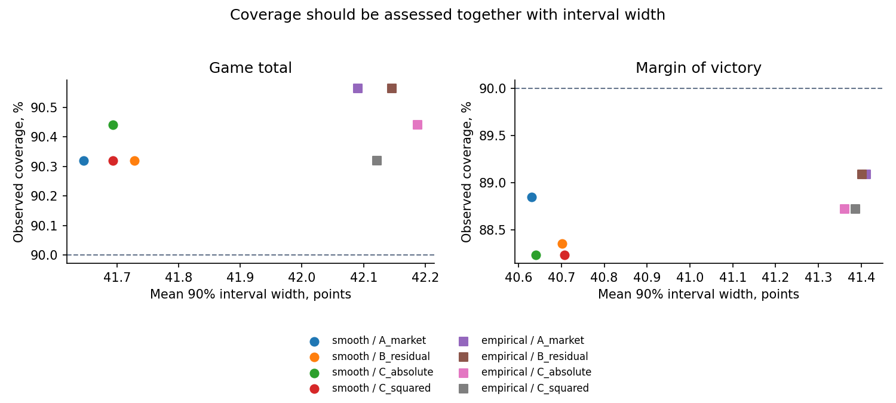
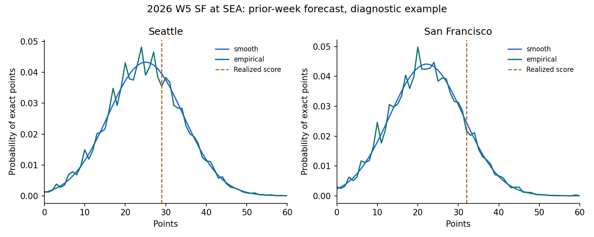

# NFL joint market and residual distribution experiment

Date: October 16, 2026.

**Historical development only.** All forecast fits and team histories use earlier whole weeks. The designs were chosen after prior NFL research was exposed; historical market quote timestamps are unknown. These are not archived native pregame forecasts.

## Findings

The lowest pooled exact joint-score log loss is **empirical__A_market**, at **7.125372** on 816 regular-season games in 2023–2025. This is an observed ranking, not a qualified selection.

Of the six fixed residual-versus-market-only joint-score comparisons, **0** have a positive lower bound after the declared six-comparison adjustment. The experiment does not establish incremental joint-score skill from the residual features.

All six added-feature variants have worse pooled joint-score point estimates than their matching A baseline. **1** have an adjusted interval wholly below zero: empirical__C_absolute.

All eight variants return negative pooled moneyline units; none beats the same-row market favorite in point estimates. Market-only empirical gives the best exact joint-score score, while market-only smooth gives the best MOV, total and team CRPS among these eight arms. The no-vig moneyline has a better winner log-loss point estimate than every new arm.

**Calibration limitation:** the raw joint models assign roughly 2.5–2.9% average tie probability versus one tie in 816 games (0.12%). These raw tie probabilities are unsuitable for operational use. Binary winner scores are conditional on a non-tie; they do not validate unconditional win/loss/tie calibration. No post-result tie correction was fitted into the fixed variants.

Probability skill, moneyline returns, and full-distribution shape are separate results. Read the paired intervals and annual tables alongside the pooled rankings. All settings are fixed; no best-result refitting or ROI optimization was performed.

## Eight fixed variants

| Information set | Mean features | Uncertainty features |
| --- | --- | --- |
| A: market only | Current spread and total, fixed quadratic terms | Current spread and total |
| B: residual means | A + scored/allowed residual EWMAs for both teams | Same market features as A |
| C: absolute residuals | Exactly B | Market + absolute residual EWMAs |
| C: squared residuals | Exactly B | Market + squared residual EWMAs |

Each is fit as a normalized smooth bivariate Gaussian lattice and as an 85% smooth / 15% conditional empirical score-pair mixture. Empirical neighbors use market context and the information set’s lagged histories. Therefore a C-versus-B empirical comparison changes both covariance predictors and empirical neighbors; the smooth comparison isolates the covariance change.

EWMA span is four team games (alpha=.4), initialized at zero with 50% offseason retention. The history is not truncated after four games. Total-residual EWMA equals scored plus allowed EWMA and is exported rather than redundantly refit.

## Moneyline returns: primary same-row sample

One flat hypothetical unit on the model’s favored side, no value filter or stake sizing. Both prices must be valid; market pick’ems are excluded. Ties push. Every row uses the intersection eligible for all eight models. ± is one game-level SE; paired intervals resample whole weeks within season. The null is the proportional no-vig moneyline probability applied to the actual quoted payout, following the repository’s conditional decisive-game convention.

| Model / control | N | W–L–P | Units | ROI ± SE | Market null |
| --- | --- | --- | --- | --- | --- |
| empirical__A_market | 812 | 554–257–1 | -0.91 | -0.11% ± 2.47 | -4.10% |
| empirical__B_residual | 812 | 550–261–1 | -8.21 | -1.01% ± 2.48 | -4.10% |
| empirical__C_absolute | 812 | 552–259–1 | -4.69 | -0.58% ± 2.47 | -4.10% |
| empirical__C_squared | 812 | 552–259–1 | -4.69 | -0.58% ± 2.47 | -4.10% |
| smooth__A_market | 812 | 552–259–1 | -4.55 | -0.56% ± 2.47 | -4.10% |
| smooth__B_residual | 812 | 548–263–1 | -11.63 | -1.43% ± 2.48 | -4.10% |
| smooth__C_absolute | 812 | 548–263–1 | -11.63 | -1.43% ± 2.48 | -4.10% |
| smooth__C_squared | 812 | 548–263–1 | -11.63 | -1.43% ± 2.48 | -4.10% |
| control_favorite | 812 | 555–256–1 | +0.18 | +0.02% ± 2.47 | -4.10% |
| control_underdog | 812 | 256–555–1 | -89.82 | -11.06% ± 4.93 | -4.10% |

| Model | ROI gain over favorite, pp | 95% paired CI, pp | Underdog picks |
| --- | --- | --- | --- |
| empirical__A_market | -0.13 | [-1.12, +0.89] | 5 |
| empirical__B_residual | -1.03 | [-2.20, +0.13] | 7 |
| empirical__C_absolute | -0.60 | [-1.60, +0.41] | 5 |
| empirical__C_squared | -0.60 | [-1.60, +0.41] | 5 |
| smooth__A_market | -0.58 | [-1.78, +0.62] | 7 |
| smooth__B_residual | -1.45 | [-2.72, -0.18] | 9 |
| smooth__C_absolute | -1.45 | [-2.72, -0.18] | 9 |
| smooth__C_squared | -1.45 | [-2.72, -0.18] | 9 |

These ROI intervals are descriptive and do not adjust for searching eight models or earlier experiments. The machine-readable results also contain ROI intervals, comparisons with the always-underdog control, excess over the price-adjusted null, and model-favorite versus model-underdog contribution totals.

## Full-distribution and winner scores

Lower is better for all scores below. CRPS is the exact discrete CDF score in points; team CRPS averages home and away. Exact joint-score NLL is the primary endpoint. Winner scores condition on a decisive game and exclude ties identically.

| Variant | Joint NLL | MOV CRPS | Total CRPS | Team CRPS | Win LL | Brier |
| --- | --- | --- | --- | --- | --- | --- |
| empirical__A_market | 7.125372 | 7.1129 | 7.2408 | 5.1112 | 0.611353 | 0.211745 |
| empirical__B_residual | 7.130520 | 7.1205 | 7.2553 | 5.1189 | 0.611925 | 0.212012 |
| empirical__C_absolute | 7.147580 | 7.1262 | 7.2565 | 5.1215 | 0.612005 | 0.212051 |
| empirical__C_squared | 7.142416 | 7.1270 | 7.2543 | 5.1216 | 0.611863 | 0.212012 |
| smooth__A_market | 7.234615 | 7.1019 | 7.2396 | 5.1061 | 0.609876 | 0.211209 |
| smooth__B_residual | 7.237411 | 7.1113 | 7.2539 | 5.1146 | 0.610568 | 0.211514 |
| smooth__C_absolute | 7.239550 | 7.1173 | 7.2579 | 5.1178 | 0.610670 | 0.211568 |
| smooth__C_squared | 7.240170 | 7.1186 | 7.2565 | 5.1181 | 0.610542 | 0.211555 |

Same-row no-vig moneyline baseline: winner LL **0.608072**, Brier **0.210334**, n=815. A moneyline supplies no unique joint-score, total or team-score distribution, so those baseline cells are intentionally not invented.

| Variant | Win LL gain over no-vig moneyline | 95% paired CI |
| --- | --- | --- |
| empirical__A_market | -0.003281 | [-0.008474, +0.001436] |
| empirical__B_residual | -0.003853 | [-0.009338, +0.001152] |
| empirical__C_absolute | -0.003932 | [-0.009683, +0.001216] |
| empirical__C_squared | -0.003790 | [-0.009451, +0.001242] |
| smooth__A_market | -0.001804 | [-0.006940, +0.002870] |
| smooth__B_residual | -0.002496 | [-0.008139, +0.002664] |
| smooth__C_absolute | -0.002597 | [-0.008352, +0.002538] |
| smooth__C_squared | -0.002470 | [-0.008216, +0.002599] |

Moneyline probability comparisons use identical decisive, valid-price rows and descriptive 95% whole-week intervals. These intervals do not cover selecting among eight models.

## Do the lagged residuals improve the joint distribution?

Positive gain favors the added information. All contrasts compare identical games within the same shape family. Intervals below are paired, season-stratified whole-week bootstrap, 10,000 draws, with nominal 99.1667% per-contrast coverage for six primary comparisons (Bonferroni nominal family level 95%).

| Added information | Comparator | Joint NLL gain | Six-comparison interval |
| --- | --- | --- | --- |
| smooth__B_residual | smooth__A_market | -0.002796 | [-0.009401, +0.003619] |
| smooth__C_absolute | smooth__A_market | -0.004936 | [-0.018202, +0.007734] |
| smooth__C_squared | smooth__A_market | -0.005556 | [-0.015237, +0.004105] |
| empirical__B_residual | empirical__A_market | -0.005149 | [-0.020102, +0.008381] |
| empirical__C_absolute | empirical__A_market | -0.022209 | [-0.042743, -0.001507] |
| empirical__C_squared | empirical__A_market | -0.017044 | [-0.035504, +0.001479] |

Other target comparisons and the C-versus-B / empirical-versus-smooth contrasts are in paired_comparisons.json with descriptive 95% intervals. Their multiplicity is not covered by the six primary intervals.

## Season consistency

| Season | Variant | N | Joint NLL | Total CRPS | Team CRPS | Win LL |
| --- | --- | --- | --- | --- | --- | --- |
| 2023 | empirical__A_market | 272 | 7.17655 | 7.2847 | 5.1791 | 0.625384 |
| 2023 | empirical__B_residual | 272 | 7.19267 | 7.2989 | 5.1814 | 0.626081 |
| 2023 | empirical__C_absolute | 272 | 7.20897 | 7.2966 | 5.1879 | 0.627379 |
| 2023 | empirical__C_squared | 272 | 7.20551 | 7.2961 | 5.1885 | 0.626751 |
| 2023 | smooth__A_market | 272 | 7.28587 | 7.2907 | 5.1812 | 0.625165 |
| 2023 | smooth__B_residual | 272 | 7.28656 | 7.3038 | 5.1836 | 0.625761 |
| 2023 | smooth__C_absolute | 272 | 7.28218 | 7.3029 | 5.1875 | 0.626638 |
| 2023 | smooth__C_squared | 272 | 7.28612 | 7.3050 | 5.1888 | 0.625958 |
| 2024 | empirical__A_market | 272 | 7.08230 | 6.9681 | 5.0309 | 0.596566 |
| 2024 | empirical__B_residual | 272 | 7.08933 | 6.9979 | 5.0499 | 0.597842 |
| 2024 | empirical__C_absolute | 272 | 7.10272 | 6.9947 | 5.0522 | 0.597155 |
| 2024 | empirical__C_squared | 272 | 7.09985 | 6.9940 | 5.0538 | 0.597400 |
| 2024 | smooth__A_market | 272 | 7.19735 | 6.9642 | 5.0188 | 0.593188 |
| 2024 | smooth__B_residual | 272 | 7.20437 | 6.9967 | 5.0400 | 0.594534 |
| 2024 | smooth__C_absolute | 272 | 7.20526 | 6.9926 | 5.0436 | 0.594183 |
| 2024 | smooth__C_squared | 272 | 7.20617 | 6.9925 | 5.0448 | 0.594397 |
| 2025 | empirical__A_market | 272 | 7.11726 | 7.4695 | 5.1235 | 0.612114 |
| 2025 | empirical__B_residual | 272 | 7.10956 | 7.4693 | 5.1255 | 0.611851 |
| 2025 | empirical__C_absolute | 272 | 7.13105 | 7.4783 | 5.1246 | 0.611478 |
| 2025 | empirical__C_squared | 272 | 7.12189 | 7.4729 | 5.1226 | 0.611435 |
| 2025 | smooth__A_market | 272 | 7.22062 | 7.4639 | 5.1181 | 0.611281 |
| 2025 | smooth__B_residual | 272 | 7.22130 | 7.4614 | 5.1202 | 0.611411 |
| 2025 | smooth__C_absolute | 272 | 7.23121 | 7.4782 | 5.1223 | 0.611189 |
| 2025 | smooth__C_squared | 272 | 7.22822 | 7.4720 | 5.1207 | 0.611273 |

## Calibration and uncertainty

| Variant | MOV 90% coverage / width | Total 90% coverage / width | Mean tie p / actual tie rate | Covariance clipped |
| --- | --- | --- | --- | --- |
| empirical__A_market | 89.09% / 41.4 | 90.56% / 42.1 | 2.50% / 0.12% | 0.00% |
| empirical__B_residual | 89.09% / 41.4 | 90.56% / 42.1 | 2.50% / 0.12% | 0.00% |
| empirical__C_absolute | 88.73% / 41.4 | 90.44% / 42.2 | 2.51% / 0.12% | 0.00% |
| empirical__C_squared | 88.73% / 41.4 | 90.32% / 42.1 | 2.51% / 0.12% | 0.00% |
| smooth__A_market | 88.85% / 40.6 | 90.32% / 41.6 | 2.87% / 0.12% | 0.00% |
| smooth__B_residual | 88.36% / 40.7 | 90.32% / 41.7 | 2.87% / 0.12% | 0.00% |
| smooth__C_absolute | 88.24% / 40.6 | 90.44% / 41.7 | 2.87% / 0.12% | 0.00% |
| smooth__C_squared | 88.24% / 40.7 | 90.32% / 41.7 | 2.87% / 0.12% | 0.00% |

Widths are in points. Discrete equal-tail intervals can exceed nominal coverage because endpoint mass is included. 50% and 80% intervals, marginal score NLLs, MAE/RMSE, non-push cover/over log loss and Brier, and winner reliability bins are exported. Cover/over scores have no actual two-sided price benchmark in this input pack; a 50% threshold is not a complete market distribution.

## Separate 2026 diagnostic

The committed schedule inputs contain 79 completed games through week 5. These results are current-season historical reconstructions, not forward captures, and are not pooled into the primary sample.

| Variant | N | Joint NLL | MOV CRPS | Total CRPS | Team CRPS | Win LL |
| --- | --- | --- | --- | --- | --- | --- |
| empirical__A_market | 79 | 7.13995 | 7.0875 | 7.3914 | 5.1172 | 0.649789 |
| empirical__B_residual | 79 | 7.15192 | 7.0504 | 7.4003 | 5.1056 | 0.645882 |
| empirical__C_absolute | 79 | 7.18200 | 7.0505 | 7.3886 | 5.1078 | 0.645004 |
| empirical__C_squared | 79 | 7.18853 | 7.0518 | 7.4001 | 5.1116 | 0.645689 |
| smooth__A_market | 79 | 7.22597 | 7.1156 | 7.3211 | 5.0984 | 0.650888 |
| smooth__B_residual | 79 | 7.21961 | 7.0742 | 7.3287 | 5.0831 | 0.647044 |
| smooth__C_absolute | 79 | 7.22913 | 7.0714 | 7.3262 | 5.0870 | 0.645547 |
| smooth__C_squared | 79 | 7.23084 | 7.0684 | 7.3350 | 5.0881 | 0.645690 |

## Earlier 2017–2022 development context

These six seasons add 1,567 earlier-data forecasts per arm. They are supplementary exposed development history, not an independently selected confirmation sample.

| Variant | N | Joint NLL | MOV CRPS | Total CRPS | Team CRPS | Win LL |
| --- | --- | --- | --- | --- | --- | --- |
| empirical__A_market | 1567 | 7.18142 | 7.1995 | 7.5609 | 5.2372 | 0.607348 |
| empirical__B_residual | 1567 | 7.19561 | 7.2109 | 7.5681 | 5.2452 | 0.608067 |
| empirical__C_absolute | 1567 | 7.23475 | 7.2153 | 7.5744 | 5.2498 | 0.607930 |
| empirical__C_squared | 1567 | 7.24476 | 7.2140 | 7.5744 | 5.2486 | 0.608011 |
| smooth__A_market | 1567 | 7.30057 | 7.2019 | 7.5646 | 5.2368 | 0.606137 |
| smooth__B_residual | 1567 | 7.30383 | 7.2155 | 7.5750 | 5.2471 | 0.606881 |
| smooth__C_absolute | 1567 | 7.32270 | 7.2215 | 7.5807 | 5.2522 | 0.606647 |
| smooth__C_squared | 1567 | 7.32974 | 7.2205 | 7.5797 | 5.2512 | 0.606846 |

## Reproduction and limits

Run `OPENBLAS_NUM_THREADS=1 python research/joint_market_residuals.py`, then `OPENBLAS_NUM_THREADS=1 python research/joint_market_residuals_report.py`. Requirements: numpy, pandas, matplotlib; pytest for the focused tests. No network access or production model imports are required. The frozen input pack permits a standalone rerun from the supplied folder layout.

All 10 output integrity checks pass, including earlier-week history/fit cutoffs, no covariance fallback in reported samples, identical game IDs, normalized PMFs, correct probability file ordering, and total/MOV identities. The separate focused tests include an adversarial own-week outcome-mutation check.

The smooth model is a Gaussian lattice approximation, not exact cell integration. Support is nonnegative integer scores 0–80 and is truncated; all input outcomes lie strictly inside its upper boundary. The model does not encode every football-impossible score pair. Tie probabilities must be inspected rather than assumed calibrated. Empirical neighbors can be sparse. Covariance safeguards clip variances to 16–400 and correlations to ±.6; clipping is reported. These fixed settings constrain what this experiment can establish.

Market lines are location proxies, not guaranteed means. Derived team points are not separately traded team totals. Historical prices have unknown capture timestamps, results include overtime, and there is no executable-price or staking claim. The bootstrap conditions on the fixed experiment and excludes earlier research/design selection uncertainty. Better distribution scores alone do not establish profitable betting.

The experiment changes no production forecast, recipe, append-only ledger or deployed page. Full per-game predictions, all marginal probabilities, illustrative joint PMFs, features, history and fit audits, frozen sources, code, tests and machine-readable summaries accompany this report.
